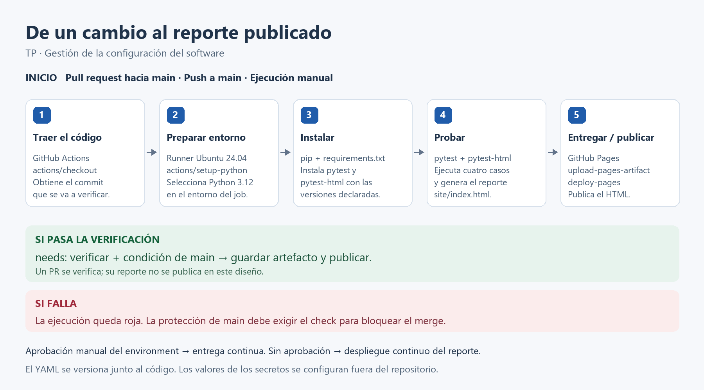

# TP: integración y entrega continua

Ejemplo mínimo para practicar GitHub Actions: una función que suma dos números,
cuatro pruebas y un reporte HTML que se publica en GitHub Pages.

[](https://github.com/Deathstone16/tp-ci-cd/actions/workflows/pipeline.yml)

**Repositorio:** [Deathstone16/tp-ci-cd](https://github.com/Deathstone16/tp-ci-cd).

**Reporte público:** [ver resultados de las pruebas](https://deathstone16.github.io/tp-ci-cd/).

**Estado comprobado:** cuatro pruebas aprobadas en GitHub Actions con Python 3.12,
reporte publicado, dos fallos de causas distintas registrados y correcciones
integradas mediante PR. `main` exige PR y el check `Verificar`, incluso para
administradores. Los dos PR de ensayo estuvieron bloqueados mientras dieron rojo.
Las [evidencias](docs/03-evidencias.md) contienen ejecuciones, commits, logs y capturas.

También se realizó una comprobación local con Python 3.11.15 en Windows.

## Recorrido

1. Leer el [plan conceptual](docs/01-plan.md).
2. Consultar la [guía para reproducir el proceso](docs/02-guia.md).
3. Revisar las [evidencias reales](docs/03-evidencias.md).
4. Practicar la [defensa y los cambios en vivo](docs/04-defensa.md).



## Archivos principales

| Archivo | Para qué sirve |
| --- | --- |
| `calculadora.py` | Implementa la suma. |
| `test_calculadora.py` | Comprueba positivos, cero, negativos y decimales. |
| `requirements.txt` | Declara las versiones de las dependencias directas. |
| `.github/workflows/pipeline.yml` | Declara los eventos, entorno, pruebas y publicación. |
| `docs/pipeline.png` | Imagen del proceso y las herramientas. |

## Ejecutarlo en Windows

Desde esta carpeta, con Python instalado:

```powershell
python -m venv .venv
.\.venv\Scripts\python.exe -m pip install -r requirements.txt
.\.venv\Scripts\python.exe -m pytest -v --html=site/index.html --self-contained-html
Start-Process .\site\index.html
```

Resultado esperado: `4 passed`. El HTML lo genera `pytest-html` a partir de las
pruebas ejecutadas; no es un reporte escrito a mano. No hace falta activar el
entorno virtual: los comandos usan directamente su ejecutable.

En Actions se pide Python 3.12 y Ubuntu 24.04. Para igualar la versión de Python
local, usar Python 3.12 al crear el entorno. Una versión menor fijada y dependencias
directas fijadas reducen variaciones; no congelan todo el sistema ni las
dependencias transitivas. Los tags mayores de las acciones también pueden cambiar.

## Cómo se comporta

Un PR dirigido a `main` ejecuta `Verificar`. Un push a `main` ejecuta la verificación
y, si pasa, publica. También se puede iniciar desde el botón de Actions; para
publicar hay que seleccionar `main`. Una rama con solo un push no ejecuta este
workflow hasta tener un PR abierto hacia `main`.

`needs: verificar` impide que la publicación avance si falla la verificación.
El check rojo por sí solo no impide un merge: hay que proteger `main` y exigir
el check, como explica la guía.

Pages usa credenciales temporales gestionadas por GitHub y permisos del job.
`DEMO_SECRET` es un ejercicio separado para demostrar el uso de secretos; no es
una credencial que necesite la suma ni el mecanismo que autentica Pages.
No se debe incluir su valor en el código, capturas ni reporte.

## Entrega o despliegue continuo

Con publicación automática después de las pruebas, este ejemplo despliega
continuamente un reporte. Para mostrar entrega continua con aprobación humana,
configurar un revisor requerido en el environment `github-pages`. Declarar
`environment` en el YAML **no crea por sí solo una aprobación manual**.

La configuración actual publica automáticamente el reporte. La consigna también
habla de entrega continua: la guía indica dónde agregar una aprobación si el
docente exige demostrar ese modo. No hay un revisor de despliegue requerido activo.

## Fuentes de consulta

- [GitHub: workflow personalizado para Pages](https://docs.github.com/en/pages/getting-started-with-github-pages/using-custom-workflows-with-github-pages).
- [GitHub: entornos y revisores requeridos](https://docs.github.com/en/actions/how-tos/deploy/configure-and-manage-deployments/manage-environments).
- [GitHub: uso de secretos](https://docs.github.com/en/actions/how-tos/write-workflows/choose-what-workflows-do/use-secrets).
- [pytest-html: generación del reporte](https://pytest-html.readthedocs.io/en/latest/user_guide.html).
