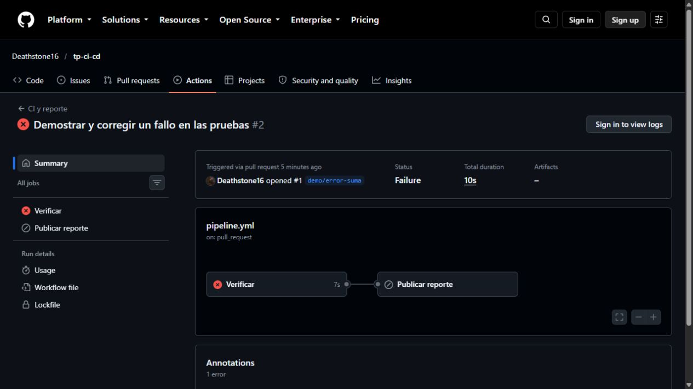
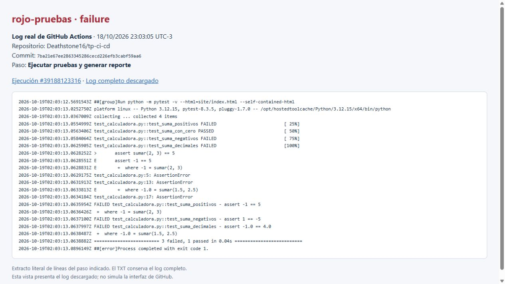
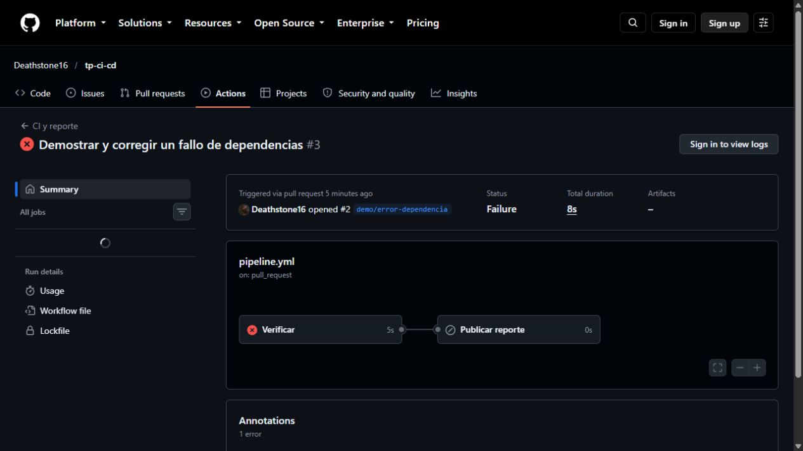
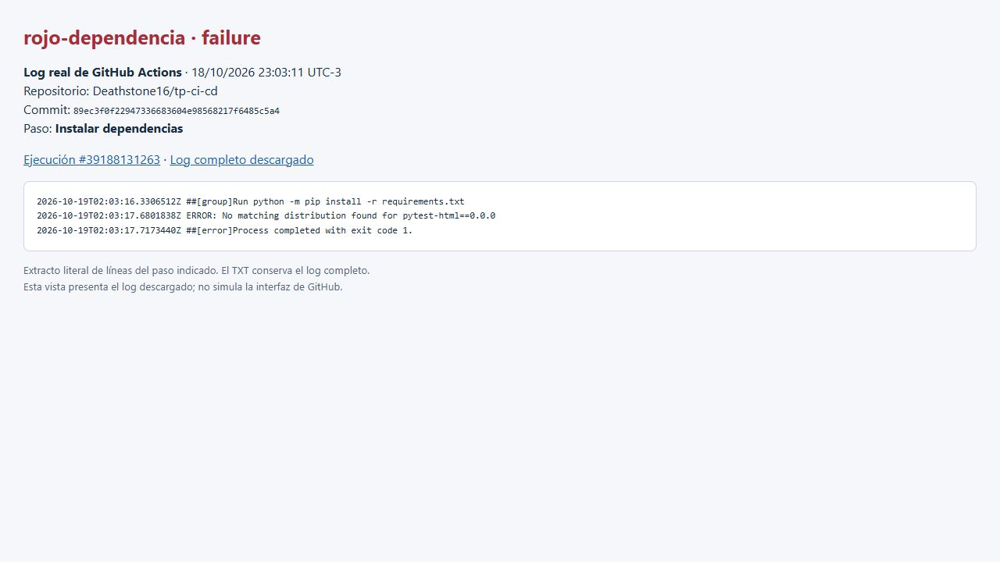
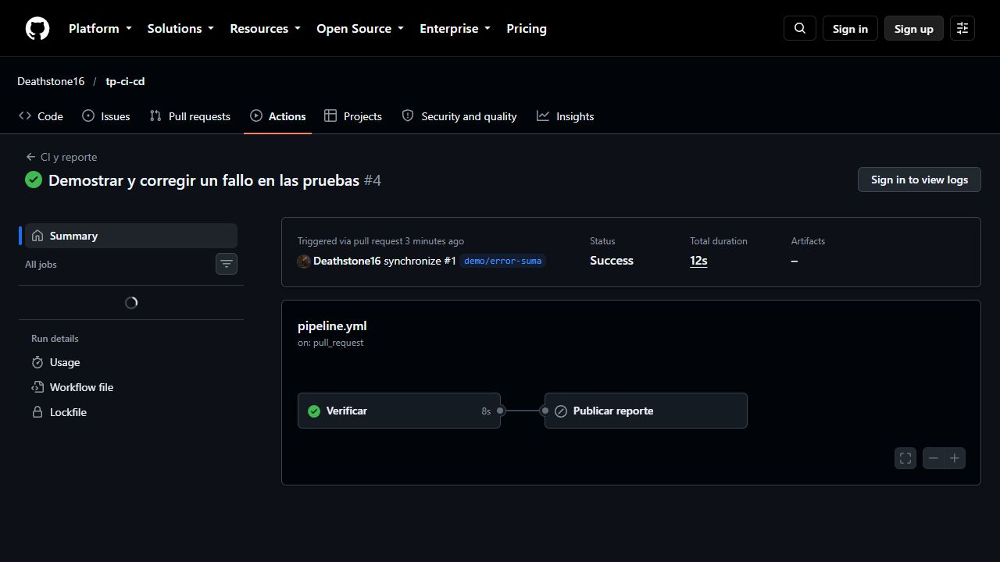
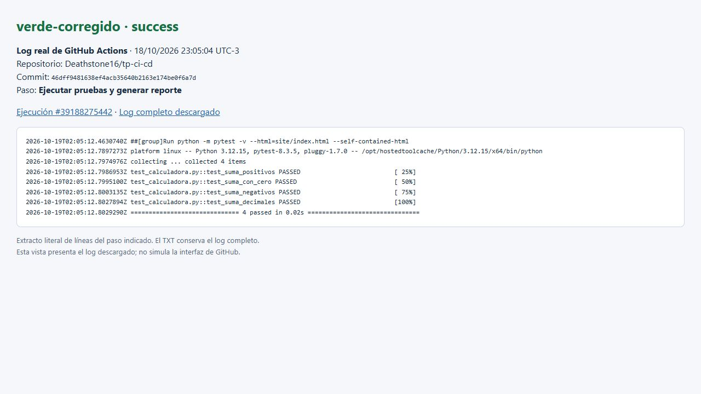
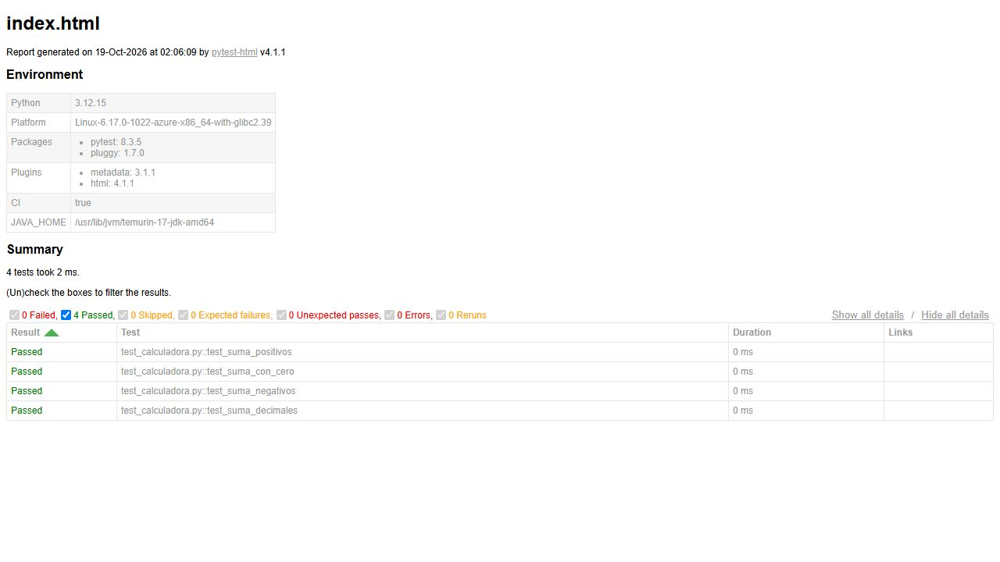

# Evidencias de las ejecuciones

Repositorio: [Deathstone16/tp-ci-cd](https://github.com/Deathstone16/tp-ci-cd).

Reporte público: [resultados publicados en Pages](https://deathstone16.github.io/tp-ci-cd/).

Las fechas de la tabla están en hora de Argentina, UTC-3. Los logs del runner
usan UTC; por eso pueden mostrar 19 de octubre aunque en Argentina sea el día 18.

| Evidencia | Commit | Ejecución | Inicio en Argentina | Resultado observado |
| --- | --- | --- | --- | --- |
| Verde inicial y publicación | `32e05c9` | [39188021335](https://github.com/Deathstone16/tp-ci-cd/actions/runs/39188021335) | 18/10/2026 23:01:45 UTC-3 | Cuatro pruebas aprobadas; publicación exitosa. |
| Rojo por suma incorrecta | `7ba21e6` | [39188123316](https://github.com/Deathstone16/tp-ci-cd/actions/runs/39188123316) | 18/10/2026 23:03:05 UTC-3 | Tres tests fallan y uno pasa; instalación correcta. |
| Rojo por dependencia inexistente | `89ec3f0` | [39188131263](https://github.com/Deathstone16/tp-ci-cd/actions/runs/39188131263) | 18/10/2026 23:03:11 UTC-3 | Falla instalación; pruebas sin ejecutar. |
| Verde al corregir la suma | `46dff94` | [39188275442](https://github.com/Deathstone16/tp-ci-cd/actions/runs/39188275442) | 18/10/2026 23:05:04 UTC-3 | Cuatro pruebas aprobadas. |

La dependencia también quedó corregida en `f449423`: la
[corrida 39188430063](https://github.com/Deathstone16/tp-ci-cd/actions/runs/39188430063)
aprobó las cuatro pruebas antes de integrar el PR 2.

## Fallo de pruebas

Se cambió temporalmente `a + b` por `a - b`. El test de positivos esperaba `5`
y recibió `-1`. pytest informó `AssertionError`, tres fallos y un caso aprobado.
El caso de cero pasó porque `7 + 0` y `7 - 0` producen el mismo valor.
La corrección restauró la suma en otro commit y la ejecución pasó.

[Log completo](evidencias/rojo-pruebas.txt) · [vista del extracto](evidencias/rojo-pruebas.html).

## Fallo de dependencias

Se pidió `pytest-html==0.0.0`. pip informó `No matching distribution found` y
terminó con código 1 en `Instalar dependencias`. No hubo resultados de tests:
el entorno no se pudo preparar. Se restauró `pytest-html==4.1.1` y el PR pasó.

[Log completo](evidencias/rojo-dependencia.txt) · [vista del extracto](evidencias/rojo-dependencia.html).

## Verde posterior a la corrección

[Log completo](evidencias/verde-corregido.txt) · [vista del extracto](evidencias/verde-corregido.html).

## Publicación

En los PR se omite el job de publicación. Después de integrar en `main`, el
workflow verifica otra vez, carga el artefacto y lo despliega en Pages.

## Protección y trazabilidad

- [PR 1: fallo de suma y corrección](https://github.com/Deathstone16/tp-ci-cd/pull/1).
- [PR 2: fallo de dependencia y corrección](https://github.com/Deathstone16/tp-ci-cd/pull/2).
- [Configuración de protección consultada por API](evidencias/proteccion-main.json).
- [Respuesta de API con ambos PR en estado BLOCKED antes de corregir](evidencias/pr-bloqueados.json).
- [Metadatos de las corridas descargadas](evidencias/corridas.json).

La protección exige PR, el check `Verificar` y una rama actualizada con `main`;
se aplica también a administradores. No se exige aprobación de otro compañero
para el PR, ni aprobación manual para desplegar el reporte.

## Origen de las capturas

Las imágenes `github-*` son capturas originales de los resúmenes de GitHub Actions.
Como el navegador no tenía sesión iniciada, GitHub pedía iniciar sesión para
mostrar el texto de los logs. Se descargaron los logs autenticados con GitHub CLI
y se capturaron sus extractos en una vista local identificada como tal.
Los TXT conservan los logs completos. Las capturas de los extractos están
identificadas como vistas locales del log descargado. El contenido completo de
los pasos también está disponible en los enlaces de Actions al iniciar sesión.
